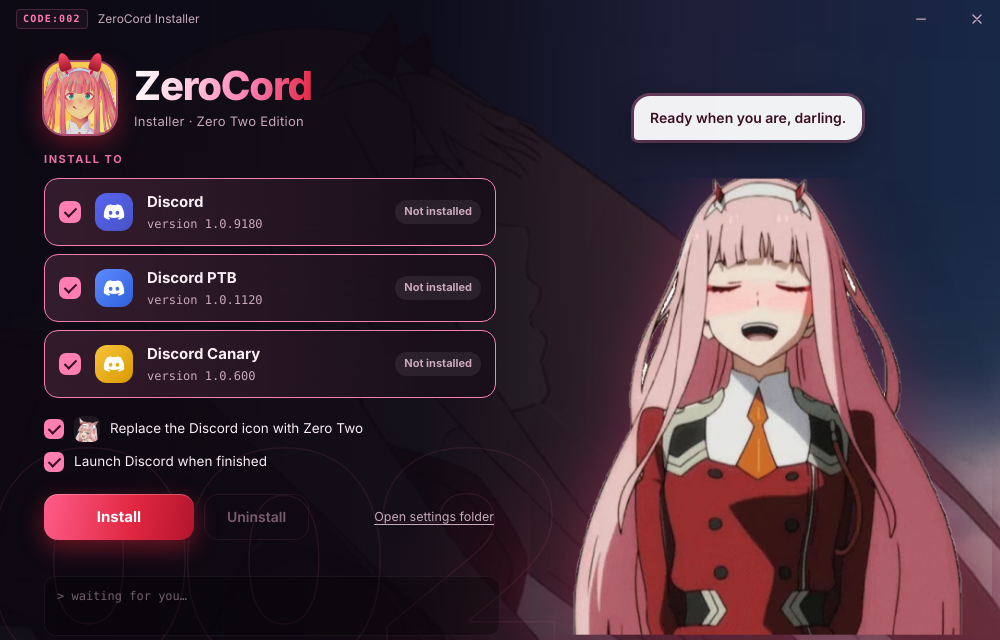
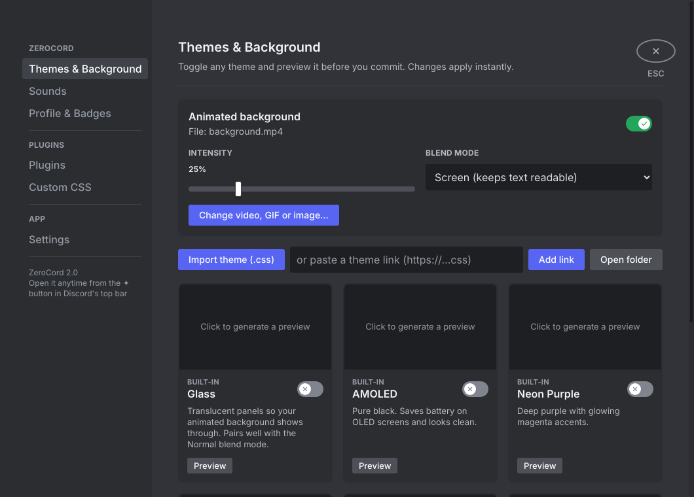

<div align="center">


# ZeroCord

**A Discord client mod with 370+ plugins, themes, custom sounds and a built-in control panel.**




</div>

## Features

| | |
|---|---|
| **Plugins** | 370+ plugins powered by [Equicord](https://github.com/Equicord/Equicord), with curated packs, search and one-click toggles. Vencord is available as an alternative engine. |
| **Control panel** | A settings panel styled after Discord's own. Open it from the ✦ icon in the top bar or with `Ctrl` + `Shift` + `M`. |
| **Themes** | Six built-in themes, live previews, and support for any `.css` theme file or link. |
| **Animated background** | Use any video, GIF or image as your Discord background, with adjustable intensity and blend modes. |
| **Custom sounds** | Replace, rebalance or mute any Discord sound individually. |
| **Profile & badges** | Change your display name, username, avatar and badges locally. Only you see these changes. |
| **Fake mute** | Appear muted to others in a call while your microphone keeps working. Toggle it with `Ctrl` + `Shift` + `Q`. |
| **Seamless install** | Installs into the official Discord Stable, PTB and Canary clients and survives Discord updates. |

<div align="center">

</div>

## Installation

1. Download **[ZeroCord-Installer.exe](https://github.com/odeiofavelado/ZeroCord/releases/latest/download/ZeroCord-Installer.exe)** from the [latest release](https://github.com/odeiofavelado/ZeroCord/releases/latest).
2. Close Discord.
3. Run `ZeroCord-Installer.exe`, select your Discord clients and click **Install**.

No Node.js or setup required. Works on Windows 10 and 11.

> [!NOTE]
> Windows SmartScreen may warn you because the installer isn't code-signed. Click **More info → Run anyway**.

<details>
<summary><b>Install from source</b></summary>

Requires [Node.js](https://nodejs.org) (LTS). Download the source (**Code → Download ZIP**), extract it and run **`Install.bat`**.

</details>

### Uninstalling

Run the installer again and click **Uninstall**. Discord goes back to normal, including its original icon. You can choose to keep or delete your settings.

### Running as a standalone app

ZeroCord can also run in its own window without touching your Discord installation:

```bash
npm install
node node_modules/electron/install.js
npm start
```

## Usage

| Shortcut | Action |
|---|---|
| `Ctrl` + `Shift` + `M` | Open the ZeroCord panel |
| `Ctrl` + `Shift` + `Q` | Toggle fake mute |

Your settings, themes, sounds and profile files are stored in `%APPDATA%\ZeroCord`. Drop any `.css` file into the `themes` folder there and it's applied instantly.

## Building

```bash
npm run build             # standalone portable app   -> dist/app
npm run build:installer   # portable installer (.exe) -> dist/installer
```

Pushing a `v*` tag builds the installer on GitHub Actions and publishes it as a release.

## Project structure

```
src/
├── core.js          Shared core: config, themes, panel IPC, plugin engine
├── patcher.js       Entry point inside the official Discord client
├── standalone.js    Entry point for the standalone app
├── preload.js       Injects the plugin engine before Discord loads
├── runtime.js       In-page features: background, sounds, profile, fake mute
├── panel/           The control panel UI
├── themes/          Built-in themes
└── vendor/          Bundled Equicord / Vencord builds
installer/           The installer app
```

## Disclaimer

Client modifications are against Discord's [Terms of Service](https://discord.com/terms). Bans for using them are rare, but you use ZeroCord at your own risk. Avoid plugins that automate actions or send messages on your behalf.

To make plugins and themes work, ZeroCord disables Discord's Content Security Policy, as Vencord and Equicord do.

## Credits

- [Equicord](https://github.com/Equicord/Equicord) and [Vencord](https://github.com/Vendicated/Vencord): plugin engines (GPL-3.0)
- [merlinfuchs/discord-badges](https://github.com/merlinfuchs/discord-badges): badge icons (MIT)
- Zero Two artwork and scenes from *Darling in the FranXX* (Studio Trigger / CloverWorks). Installer icon art by **fantoramu**.

ZeroCord is not affiliated with Discord Inc.

## License

[GPL-3.0](LICENSE)
