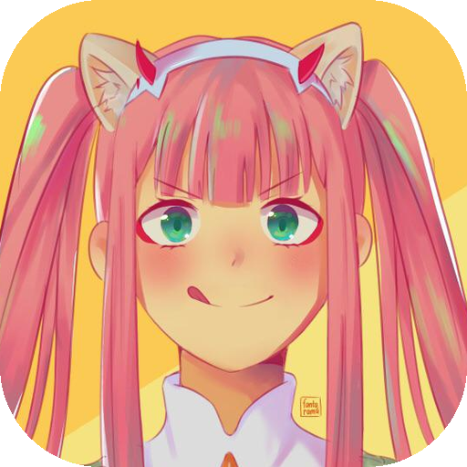

<p align="center">
  
</p>

<h1 align="center">ZeroCord</h1>
<p align="center">Discord com plugins, temas, sons, perfil personalizado e painel próprio · edição Zero Two</p>

---

## O que tem

- **Mais de 370 plugins** do [Equicord](https://github.com/Equicord/Equicord), com busca e liga/desliga no painel
- **Painel ✦** no visual do Discord (abre pelo ícone no canto de cima ou com `Ctrl + Shift + M`)
- **Temas** com prévia, 6 temas prontos e importação de `.css` ou link
- **Fundo animado** com vídeo, GIF ou imagem
- **Sons**: troque, ajuste o volume ou silencie qualquer som do Discord
- **Perfil e badges** personalizados (só você vê)
- **Mute falso**: na call você aparece mutado e continua falando (`Ctrl + Shift + Q`)
- **Instala dentro do Discord oficial**: Normal, PTB e Canary, com o ícone da Zero Two

## Como instalar (Windows)

1. Instale o [Node.js](https://nodejs.org) (versão **LTS**)
2. Baixe este projeto: botão verde **Code → Download ZIP**, depois extraia
3. Feche o Discord e dê dois cliques em **`Instalar.bat`**
4. Marque em quais Discords quer instalar e clique em **Instalar**

Na primeira vez o `Instalar.bat` baixa o Electron (uns 100 MB), então demora um pouco.

> O Windows pode mostrar o aviso azul "O Windows protegeu o computador", porque o instalador não tem assinatura digital. Clique em **Mais informações → Executar assim mesmo**.

### Desinstalar
Abra o `Instalar.bat` de novo e clique em **Desinstalar**. O Discord volta ao normal, com o ícone original.

### Usar como app separado (sem mexer no Discord)
```
npm install
node node_modules\electron\install.js
npm start
```

## Onde ficam as coisas

| O quê | Onde |
|---|---|
| Configurações, temas, sons, perfil e fundo | `%APPDATA%\ZeroCord` |
| Temas `.css` seus | `%APPDATA%\ZeroCord\temas` |

## Avisos

- Mods de cliente vão contra os termos de uso do Discord. Ban por isso é raro, mas use por sua conta.
- Se você já usa o Vencord ou o Equicord oficial, desinstale antes: o ZeroCord já inclui o Equicord.
- Pra plugins e temas funcionarem, o ZeroCord desliga a CSP do Discord (como o Vencord e o Equicord também fazem).

## Créditos

- Plugins: [Equicord](https://github.com/Equicord/Equicord) e [Vencord](https://github.com/Vendicated/Vencord) (GPL-3.0)
- Ícones das badges: [merlinfuchs/discord-badges](https://github.com/merlinfuchs/discord-badges) (MIT)
- Zero Two e cenas: *Darling in the FranXX* (Studio Trigger / CloverWorks). Arte do ícone do instalador por **fantoramu**.
